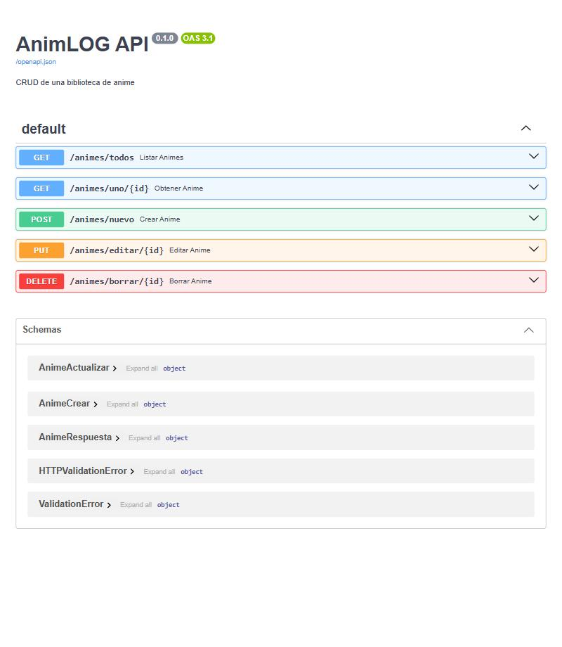
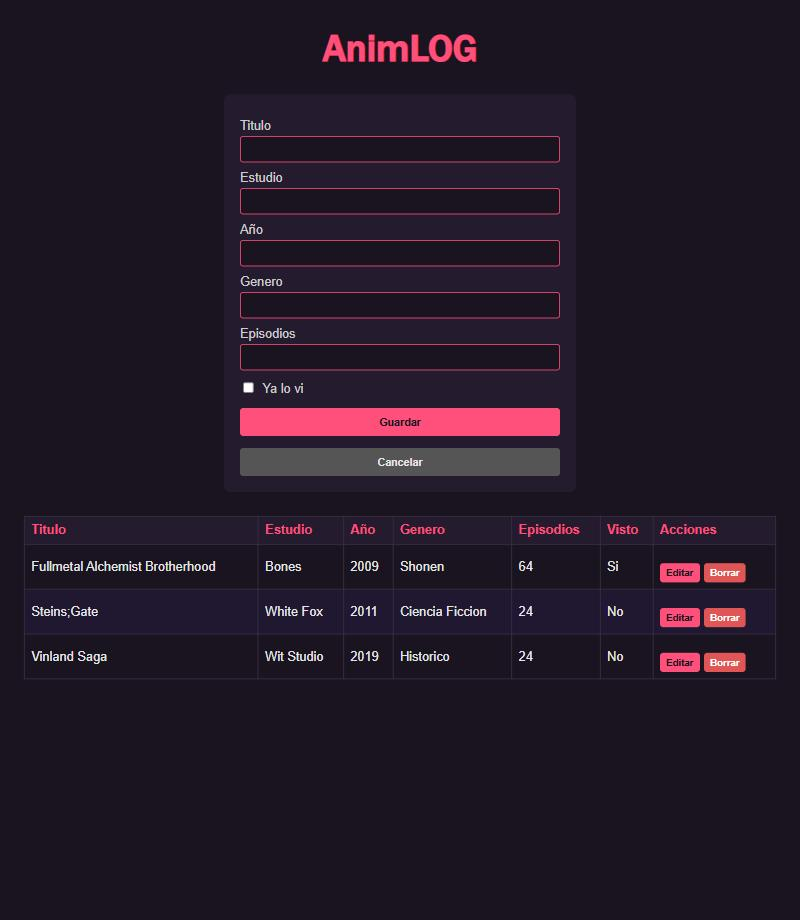
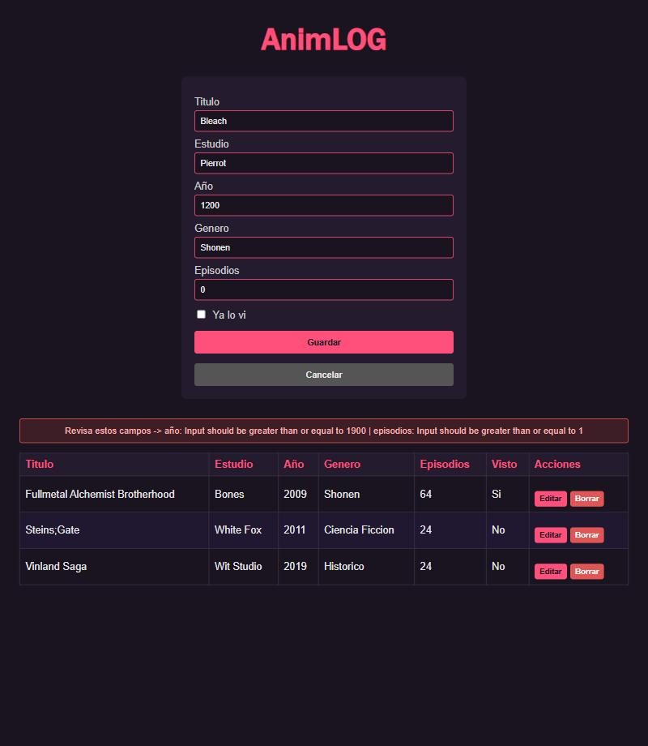
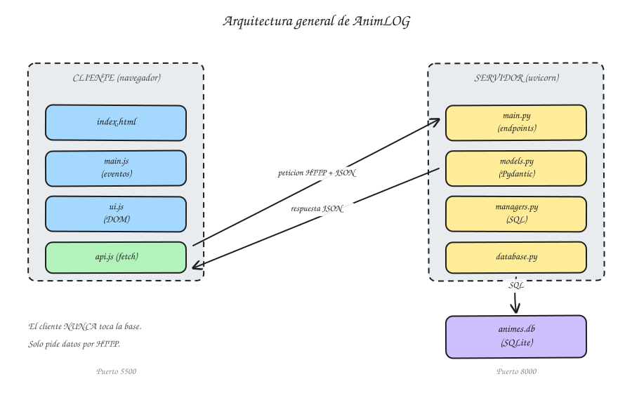
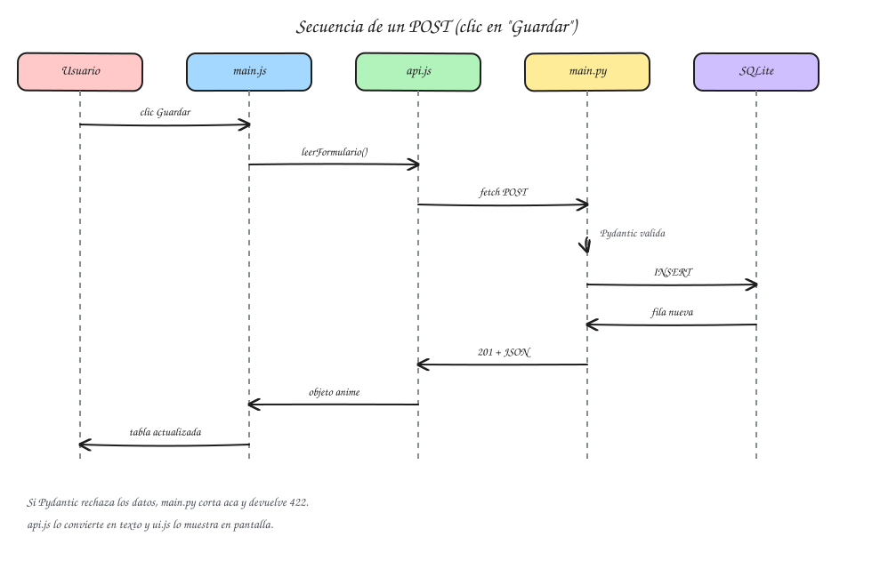
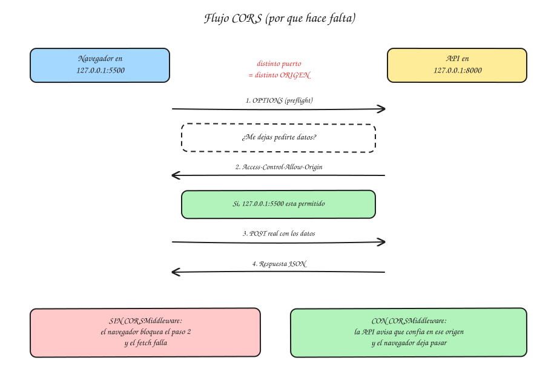

# AnimLOG — Biblioteca de Anime

**Alumno:** Meske Juan Cruz
**Curso:** 6to 5ta
**Materia:** Laboratorio de Programación — TP Evaluativo Full Stack

---

## 1. Tema elegido

**AnimLOG** es una aplicación full stack para llevar un registro de animes:
qué viste, de qué estudio es, de qué año y cuántos episodios tiene.

Elegí este tema porque abarca los datos necesarios para poder completar este trabajo (iba a hacerlo de juegos pero eso ya lo hizo otro compañero).

La entidad principal es **Anime** y tiene 7 campos:

| Campo | Tipo | Obligatorio | Validación |
|---|---|---|---|
| `id` | int | lo genera SQLite | clave primaria autoincremental |
| `titulo` | str | sí | entre 1 y 100 caracteres |
| `estudio` | str | sí | entre 1 y 100 caracteres |
| `año` | int | sí | entre 1900 y 2100 |
| `genero` | str | sí | entre 1 y 50 caracteres |
| `episodios` | int | sí | entre 1 y 10000 |
| `visto` | bool | **no** | si no viene, se guarda `false` |

---

## 2. Tecnologías usadas

### Backend
- **Python 3** — lenguaje del servidor.
- **FastAPI** — framework web. Lo elegí (sobre Flask) porque valida los datos solo
  con Pydantic y genera la documentación interactiva sin escribir una línea extra.
- **Uvicorn** — el servidor que realmente corre la app y escucha el puerto 8000.
- **Pydantic** — define qué forma tiene que tener el JSON que entra y sale.
- **sqlite3** — módulo que viene con Python. SQL escrito a mano, sin ORM.
- **SQLite** — la base es un único archivo `animes.db`, no hace falta instalar
  ningún motor de base de datos aparte.

### Frontend
- **HTML5** — estructura.
- **CSS3** — estilos propios, sin Bootstrap ni ninguna librería.
- **JavaScript Vanilla** — `fetch` para hablar con la API y DOM para la pantalla.
  Sin React, sin jQuery, sin nada externo.

---

## 3. Cómo instalar y ejecutar

> Probado desde cero en Windows con Python 3.14.

### 3.1 Backend

```bash
cd backend
python -m venv venv
```

Activar el entorno virtual:

```bash
# Windows (PowerShell)
venv\Scripts\activate

# Linux / Mac
source venv/bin/activate
```

Instalar las dependencias y arrancar:

```bash
pip install -r requirements.txt
uvicorn main:app --reload
```

La API queda corriendo en **http://127.0.0.1:8000**.
La primera vez se crea solo el archivo `animes.db` con la tabla adentro.

### 3.2 Documentación interactiva (Swagger)

Con el backend corriendo, entrá a:

**http://127.0.0.1:8000/docs**

FastAPI arma esa página sola a partir de los modelos Pydantic y los endpoints.
Desde ahí se puede probar cada endpoint con el botón *Try it out*, sin necesidad
de Postman ni del frontend.



También existe `/redoc`, que es la misma info con otro diseño.

### 3.3 Frontend

Con el backend ya corriendo, abrir el frontend en **otra** terminal o ventana:

- **Opción A (la que usé):** abrir `frontend/index.html` en VS Code, click derecho
  → *Open with Live Server*. Queda en `http://127.0.0.1:5500`.
- **Opción B:** servir la carpeta a mano:

```bash
cd frontend
python -m http.server 5500
```

> **Importante:** no hay que abrir el `index.html` con doble clic. Si se abre como
> `file://` el navegador lo trata como un origen distinto (`null`) y CORS bloquea
> todos los pedidos. Tiene que servirse por HTTP desde el puerto 5500, que es el
> que el backend tiene permitido.

---

## 4. Endpoints

Base: `http://127.0.0.1:8000`

| Método | Ruta | Qué hace | Éxito |
|---|---|---|---|
| GET | `/animes/todos` | Lista todos los animes | 200 |
| GET | `/animes/uno/{id}` | Trae uno solo por id | 200 |
| POST | `/animes/nuevo` | Crea uno nuevo | 200 |
| PUT | `/animes/editar/{id}` | Modifica uno existente | 200 |
| DELETE | `/animes/borrar/{id}` | Elimina uno | 200 |

### GET `/animes/todos`

**Request:** no lleva body.

**Response 200:**
```json
[
  {
    "titulo": "Fullmetal Alchemist Brotherhood",
    "estudio": "Bones",
    "año": 2009,
    "genero": "Shonen",
    "episodios": 64,
    "visto": true,
    "id": 1
  },
  {
    "titulo": "Steins;Gate",
    "estudio": "White Fox",
    "año": 2011,
    "genero": "Ciencia Ficcion",
    "episodios": 24,
    "visto": false,
    "id": 3
  }
]
```

### GET `/animes/uno/1`

**Response 200:**
```json
{
  "titulo": "Fullmetal Alchemist Brotherhood",
  "estudio": "Bones",
  "año": 2009,
  "genero": "Shonen",
  "episodios": 64,
  "visto": true,
  "id": 1
}
```

### POST `/animes/nuevo`

**Request:**
```json
{
  "titulo": "Vinland Saga",
  "estudio": "Wit Studio",
  "año": 2019,
  "genero": "Historico",
  "episodios": 24,
  "visto": false
}
```

**Response 200:** devuelve el anime ya guardado, con el `id` que generó SQLite.
```json
{
  "titulo": "Vinland Saga",
  "estudio": "Wit Studio",
  "año": 2019,
  "genero": "Historico",
  "episodios": 24,
  "visto": false,
  "id": 4
}
```

Como `visto` es opcional, este request también es válido y guarda `visto: false`:
```json
{
  "titulo": "Steins;Gate",
  "estudio": "White Fox",
  "año": 2011,
  "genero": "Ciencia Ficcion",
  "episodios": 24
}
```

### PUT `/animes/editar/3`

Todos los campos son opcionales, así que se puede mandar **solo lo que cambió**:

**Request:**
```json
{ "visto": true }
```

**Response 200:** el resto de los campos quedan como estaban.
```json
{
  "titulo": "Steins;Gate",
  "estudio": "White Fox",
  "año": 2011,
  "genero": "Ciencia Ficcion",
  "episodios": 24,
  "visto": true,
  "id": 3
}
```

### DELETE `/animes/borrar/3`

**Response 200:**
```json
{ "mensaje": "anime borrado" }
```

### Ejemplo de error 422

**Request con datos inválidos:**
```json
{
  "titulo": "",
  "estudio": "Pierrot",
  "año": 1200,
  "genero": "Shonen",
  "episodios": 0
}
```

**Response 422:** FastAPI corta antes de llegar al Manager y detalla cada campo.
```json
{
  "detail": [
    {
      "type": "string_too_short",
      "loc": ["body", "titulo"],
      "msg": "String should have at least 1 character",
      "input": ""
    },
    {
      "type": "greater_than_equal",
      "loc": ["body", "año"],
      "msg": "Input should be greater than or equal to 1900",
      "input": 1200
    },
    {
      "type": "greater_than_equal",
      "loc": ["body", "episodios"],
      "msg": "Input should be greater than or equal to 1",
      "input": 0
    }
  ]
}
```

---

## 5. Capturas del frontend funcionando

### Listado con datos cargados


### Error de validación 422 mostrado en pantalla
El backend devuelve el 422, `api.js` lo traduce a un texto legible y `ui.js` lo
pinta en el cartel rojo. El usuario nunca ve el JSON crudo.



---

## 6. Diagramas

### 6.1 Arquitectura general


### 6.2 Secuencia de un POST


### 6.3 Flujo CORS


> Los tres diagramas están hechos en Excalidraw. Los archivos `.excalidraw` están
> en la carpeta `docs/` y se pueden abrir y editar en https://excalidraw.com
> (Menú → *Open* → elegir el archivo).

### 6.4 Versión explicada para cualquier persona

Además del README, armé un PDF que explica el proyecto **sin tecnicismos**, con la
analogía de un restaurante (el mozo, la cocina y la heladera). Sirve para que alguien
que no programa entienda cómo funciona:

**[docs/AnimLOG-explicado-facil.pdf](docs/AnimLOG-explicado-facil.pdf)**

---

## 7. Preguntas de arquitectura

### 7.1 ¿Qué pasa desde que hago clic en "Guardar" hasta que se actualiza la pantalla?

Cuando apreto "Guardar" no pasa una cosa sola: pasa una cadena de pasos donde cada
archivo hace su parte y le entrega el resultado al siguiente.


Paso a paso, siguiendo el código real del proyecto:

1. **El navegador dispara el evento `submit`** del formulario. En `main.js` tengo un
   `addEventListener("submit", ...)` escuchando. Lo primero que hace es
   `evento.preventDefault()`, porque si no el navegador recargaría la página entera
   (que es el comportamiento por defecto de un formulario HTML) y perdería todo.

2. **`main.js` junta los datos.** Le pide a `ui.js` que lea los inputs con
   `leerFormulario()`. Ahí también convierto `año` y `episodios` a número con
   `Number()`, porque un input HTML siempre devuelve string y la API espera un `int`.

3. **`main.js` prende el cartel de "Cargando..."** y le pasa el objeto a `api.js`.
   Hasta acá nadie salió de la computadora todavía.

4. **`api.js` hace el `fetch`.** Serializa el objeto con `JSON.stringify()` y lo manda
   con `method: "POST"` y el header `Content-Type: application/json`. Recién en este
   punto la información sale del navegador y viaja por la red al puerto 8000.

5. **Uvicorn recibe la petición** y se la entrega a FastAPI.

6. **Pydantic valida ANTES de que se ejecute mi función.** Si el JSON no cumple
   (título vacío, año 1200, episodios 0), FastAPI ni siquiera llama a
   `crear_anime()`: corta ahí y devuelve 422. Si cumple, arma un objeto `AnimeCrear`.

7. **`Depends(get_db)` abre la conexión** a SQLite y se la pasa al endpoint.

8. **El endpoint llama al Manager.** `crear_anime()` no escribe SQL: instancia
   `AdministradorAnimes` con la conexión y llama a `admin.agregar(anime)`.

9. **El Manager ejecuta el `INSERT`** y hace `commit()`. Sin el commit los datos
   quedarían solo en memoria y se perderían. Después hace un `SELECT` del id recién
   creado para devolver el registro completo.

10. **La respuesta vuelve.** FastAPI la filtra contra `AnimeRespuesta`, la convierte a
    JSON y la manda de vuelta. `get_db` cierra la conexión en su `finally`.

11. **`api.js` recibe la respuesta**, verifica que el status sea OK y devuelve el objeto.

12. **`main.js` limpia el formulario y vuelve a pedir la lista completa.** Con esa lista
    nueva llama a `pintarTabla()` de `ui.js`, que borra las filas viejas y dibuja las
    nuevas. Apaga el "Cargando..." y recién ahí el usuario ve el anime en la tabla.

Lo importante es que **la pantalla no se actualiza sola**: se actualiza porque yo
vuelvo a pedir los datos y los redibujo. La página nunca se recarga.

---

### 7.2 ¿Quién es el cliente y quién el servidor? ¿En qué se diferencia de una app de escritorio?


**El cliente** es el navegador con `index.html`, `style.css`, `api.js`, `ui.js` y
`main.js`. Corre en la máquina del usuario, en el puerto 5500. No sabe nada de SQL
ni tiene idea de que existe un archivo `animes.db`. Lo único que sabe es pedirle
JSON a una dirección.

**El servidor** es el proceso de Uvicorn en el puerto 8000, con `main.py`,
`models.py`, `managers.py`, `database.py` y la base `animes.db`. Es el único que
toca los datos.

La diferencia principal con una app de escritorio:

| | App de escritorio | Esta app web |
|---|---|---|
| **Dónde corre** | Todo en una sola máquina | Partido en dos procesos que se hablan por red |
| **Dónde están los datos** | En el disco del usuario | En el servidor, centralizados |
| **Instalación** | Hay que instalarla en cada PC | Se entra con el navegador, no se instala nada |
| **Actualizar** | Reinstalar en cada máquina | Se actualiza el servidor y listo |
| **Varios usuarios** | Cada uno con su copia de datos aislada | Todos ven los mismos datos |
| **Comunicación** | Llamadas a funciones en memoria | Peticiones HTTP que pueden fallar |

La consecuencia que más se nota al programar es la última: **en una app de escritorio
llamás a una función y sabés que va a responder**. Acá la llamada sale a la red y puede
no volver nunca (servidor apagado, sin internet, puerto cambiado). Por eso todo el
`fetch` está envuelto en un `try/catch` y por eso hay estados de "Cargando...": porque
la respuesta tarda y puede fallar, cosa que en una app de escritorio no pasa.

---

### 7.3 ¿Qué métodos HTTP y qué códigos de estado usa el proyecto?

El método HTTP dice **qué intención** tiene la petición, y el código de estado dice
**cómo salió**. Usar el método correcto no es un detalle estético: GET no tiene que
modificar nada, y DELETE tiene que borrar y nada más.

| Operación | Método | Ruta | Éxito | Error posible |
|---|---|---|---|---|
| Listar todos | GET | `/animes/todos` | 200 OK | 500 si falla la base |
| Obtener uno | GET | `/animes/uno/{id}` | 200 OK | 422 si el id no es un número |
| Crear | POST | `/animes/nuevo` | 200 OK | **422** si falla la validación |
| Modificar | PUT | `/animes/editar/{id}` | 200 OK | **422** si falla la validación |
| Eliminar | DELETE | `/animes/borrar/{id}` | 200 OK | 422 si el id no es un número |

Las familias de códigos:

| Rango | Significa | Ejemplo acá |
|---|---|---|
| **2xx** | Salió bien | 200 en todas las operaciones |
| **3xx** | Redirección | no se usa |
| **4xx** | **El cliente se equivocó** | 422 cuando mando año 1200 |
| **5xx** | **El servidor se rompió** | 500 si la base está corrupta |

La distinción 4xx vs 5xx importa para saber a quién echarle la culpa: con un 4xx el
problema está en lo que mandé y reintentar igual no sirve; con un 5xx el pedido estaba
bien y el que falló es el servidor.

El 422 es el que más se ve en este proyecto, y lo genera Pydantic solo. En `api.js`
lo trato aparte justamente porque es el único error que tiene información útil para
mostrarle al usuario (qué campo está mal y por qué).

---

### 7.4 ¿Qué es el SOP y por qué hace falta CORS?


El **SOP (Same-Origin Policy)** es una regla de seguridad que traen todos los
navegadores. Dice que una página solo puede leer respuestas de **su mismo origen**.

Un origen son tres cosas juntas: **protocolo + dominio + puerto**. Si cambia una sola,
ya es otro origen:

| Origen A | Origen B | ¿Mismo origen? |
|---|---|---|
| `http://127.0.0.1:5500` | `http://127.0.0.1:5500/otra.html` | Sí (solo cambia la ruta) |
| `http://127.0.0.1:5500` | `http://127.0.0.1:8000` | **No** (distinto puerto) |
| `http://127.0.0.1:5500` | `https://127.0.0.1:5500` | **No** (distinto protocolo) |

**Por qué existe:** sin el SOP, si yo entro a una página cualquiera, esa página podría
hacer un `fetch` al homebanking donde estoy logueado, leer la respuesta con mis datos
y mandársela al atacante. El navegador manda las cookies de sesión solas, así que la
petición saldría autenticada. El SOP corta eso: el pedido puede llegar a salir, pero
**el navegador no deja que el JavaScript lea la respuesta**.

**Mi problema:** el frontend está en el 5500 y la API en el 8000. Para el navegador
son dos orígenes distintos, así que por defecto bloquea.

**CORS (Cross-Origin Resource Sharing)** es el mecanismo para destrabarlo de forma
controlada. No "apaga" el SOP: lo que hace es permitir que **el servidor** declare en
quién confía, mediante headers de respuesta.

Cómo funciona el preflight: antes del POST real, el navegador manda solo una petición
`OPTIONS` preguntando "¿me dejás?". Si la API responde con el header
`Access-Control-Allow-Origin: http://127.0.0.1:5500`, el navegador deja pasar el POST
de verdad. Si no responde eso, corta ahí y el `fetch` falla.

En `main.py` lo configuro así:

```python
app.add_middleware(
    CORSMiddleware,
    allow_origins=["http://127.0.0.1:5500", "http://localhost:5500"],
    allow_methods=["*"],
    allow_headers=["*"],
)
```

Puse los dos orígenes porque `localhost` y `127.0.0.1` son el mismo lugar para una
persona pero **orígenes distintos** para el navegador, y Live Server puede abrir
cualquiera de los dos.

Lo que **no** hay que hacer en producción es dejar `allow_origins=["*"]`, porque eso
le dice a la API que acepte pedidos de cualquier página de internet. Para desarrollo
local es cómodo; en una app real hay que listar los dominios propios.

---

### 7.5 ¿Para qué sirve separar en Managers y qué aporta la inyección de dependencias?

**La separación de responsabilidades** es que cada archivo tenga un solo trabajo:

| Archivo | Su único trabajo |
|---|---|
| `main.py` | Recibir peticiones HTTP y devolver respuestas |
| `models.py` | Definir la forma de los datos y validarlos |
| `managers.py` | Hablar con la base (todo el SQL vive acá) |
| `database.py` | Abrir y cerrar la conexión |

El endpoint **no escribe SQL**. Hace esto:

```python
@app.post("/animes/nuevo", response_model=AnimeRespuesta)
def crear_anime(anime: AnimeCrear, conexion=Depends(get_db)):
    admin = AdministradorAnimes(conexion)
    return admin.agregar(anime)
```

Las ventajas concretas:

- **Si cambio de base de datos**, toco solo `managers.py`. Los endpoints quedan igual
  porque siguen llamando a `agregar()`, no les importa qué hay abajo.
- **Si hay un bug en una query**, sé exactamente dónde buscar. No tengo que leer los
  cinco endpoints a ver en cuál se me escapó un SQL mal escrito.
- **No repito SQL.** El `SELECT` por id está escrito una sola vez en `ver_uno()`, y lo
  reusan el GET, el POST (para devolver lo recién creado) y el PUT.

**La inyección de dependencias** es que el endpoint **no crea** la conexión: la recibe
ya lista desde afuera, con `Depends(get_db)`. La función es así:

```python
def get_db():
    conexion = sqlite3.connect(NOMBRE_BASE)
    conexion.row_factory = sqlite3.Row
    try:
        yield conexion
    finally:
        conexion.close()
```

Lo que aporta:

- **La conexión se cierra siempre.** El `finally` corre aunque el endpoint lance una
  excepción. Si cada endpoint abriera y cerrara a mano, un error en el medio dejaría
  la conexión abierta para siempre.
- **La configuración está en un solo lugar.** El `row_factory = sqlite3.Row` (que es lo
  que me deja hacer `fila["titulo"]` en vez de `fila[0]`) está escrito una vez. Si me
  olvido de ponerlo en un endpoint, ese endpoint rompe de una forma rarísima.
- **Se puede testear.** Para los tests puedo reemplazar `get_db` por uno que apunte a
  una base de prueba, sin tocar ni una línea de los endpoints.

**Qué pasa si abro conexiones sueltas por todos lados** (que es como lo tenía al
principio): cada función abre la suya y tiene que acordarse de cerrarla. Si una
revienta antes del `close()`, esa conexión queda colgada. Con suficientes peticiones se
acumulan hasta que el proceso se queda sin descriptores de archivo y la app se cae. Y
como SQLite bloquea el archivo al escribir, conexiones abandonadas pueden dejar la base
trabada y hacer fallar escrituras que no tienen nada que ver.

---

### 7.6 ¿Por qué JSON y cómo valida Pydantic?

**JSON** es el formato con el que viajan los datos entre el frontend y el backend.
Se usa porque:

- **Es texto plano**, así que viaja por HTTP sin problema.
- **Los dos lados lo entienden.** JavaScript lo convierte con `JSON.stringify()` y
  `JSON.parse()`; Python con el módulo `json` (y FastAPI lo hace solo).
- **Es independiente del lenguaje.** Si mañana reescribo el frontend en otra cosa, el
  backend no se entera.
- **Se lee a simple vista**, lo cual ayuda muchísimo para debuggear.

Un detalle importante: JSON **no tiene tipos fuertes**. Nada impide mandar
`"año": "mil doscientos"`. Por eso hace falta validar.

**Pydantic** es el que pone las reglas. Definí cuatro modelos, cada uno para un momento
distinto:

```python
class AnimeBase(BaseModel):          # campos y validaciones comunes
    titulo: str = Field(min_length=1, max_length=100)
    año: int = Field(ge=1900, le=2100)
    episodios: int = Field(ge=1, le=10000)
    visto: bool = False              # opcional: si no viene, es False

class AnimeCrear(AnimeBase):         # POST: sin id, lo genera SQLite
    pass

class AnimeActualizar(BaseModel):    # PUT: todo opcional
    titulo: Optional[str] = None
    ...

class AnimeRespuesta(AnimeBase):     # lo que sale de la API
    id: int
```

Separarlos no es por gusto: el POST **no debe** aceptar un `id` (lo pone la base), y el
PUT **sí debe** aceptar campos faltantes para poder mandar solo lo que cambió. Con un
solo modelo para todo, una de las dos cosas queda mal.

Pydantic valida **antes** de que corra mi función. Si falla, FastAPI devuelve 422 y mi
código ni se entera, así que al Manager nunca le llegan datos rotos.

**Ejemplo real de request inválido:**

```json
{ "titulo": "", "estudio": "Pierrot", "año": 1200, "genero": "Shonen", "episodios": 0 }
```

**Respuesta 422** (acortada). Notar que informa **todos** los errores juntos, no solo
el primero, y que `loc` dice exactamente qué campo falló:

```json
{
  "detail": [
    { "loc": ["body", "titulo"],    "msg": "String should have at least 1 character" },
    { "loc": ["body", "año"],       "msg": "Input should be greater than or equal to 1900" },
    { "loc": ["body", "episodios"], "msg": "Input should be greater than or equal to 1" }
  ]
}
```

En `api.js` recorro ese array y armo un texto legible, que es lo que termina viéndose
en el cartel rojo de la captura de la sección 5.

---

### 7.7 ¿Qué es que HTTP sea "stateless" y dónde vive el estado?

**Stateless (sin estado)** significa que **el servidor no se acuerda de nada entre una
petición y la siguiente**. Cada petición llega como si fuera la primera y tiene que
traer toda la información necesaria para entenderse sola.

Si hago `GET /animes/todos` y después `DELETE /animes/borrar/3`, el servidor no tiene
ni idea de que las dos vinieron de la misma persona. Por eso el DELETE lleva el id en
la URL: si no se lo digo, no hay forma de que lo adivine.

**Dónde vive el estado en este proyecto:**

| Qué | Dónde vive | Cuánto dura |
|---|---|---|
| Los animes guardados | `animes.db` (archivo SQLite en el servidor) | Para siempre, hasta que se borren |
| La lista que se muestra | Variable `listaAnimes` en `main.js` (memoria del navegador) | Se pierde al recargar la página |
| El anime que estoy editando | Input `idAnime` escondido en el HTML | Hasta que guardo o cancelo |
| **En el servidor, entre peticiones** | **Nada** | — |

Esto se ve clarito en `database.py`: la conexión se abre al empezar la petición y se
cierra al terminar. No queda nada vivo esperando la próxima.

**Ventaja de ser stateless si tuviera que escalar a 3 servidores:**

Si la app se llena de usuarios, puedo poner tres servidores iguales con un balanceador
de carga adelante repartiendo las peticiones.

Como ningún servidor guarda estado en memoria, **da exactamente lo mismo cuál atienda
cada petición**. Mi primer pedido puede ir al servidor 1, el segundo al 3 y el tercero
al 2, y el resultado es idéntico. Si uno se cae, los otros siguen atendiendo sin que el
usuario note nada.

Si el servidor guardara estado en memoria (por ejemplo la lista del usuario en una
variable), esto se rompería: el usuario quedaría "pegado" al servidor 1 y si ese se cae
pierde todo. Habría que armar sesiones pegajosas o un almacén de sesiones compartido,
que es trabajo y complejidad extra.

El único punto que **sí** habría que resolver es la base: los tres servidores tendrían
que apuntar a la misma, y SQLite (que es un archivo local) no sirve para eso. Habría
que pasar a PostgreSQL o MySQL. Pero gracias a la separación en Managers, ese cambio
toca solo `database.py` y `managers.py`; los endpoints y todo el frontend quedan igual.

---

## 8. Criterios de diseño

### Backend

**Carpetas planas en vez de subcarpetas.** `models.py` y `managers.py` son archivos
sueltos y no paquetes con `__init__.py`. Con una sola entidad, armar subcarpetas
agregaba ruido sin ganar nada.

**Nombres en español.** `AdministradorAnimes`, `ver_todos()`, `agregar()`. Mezclar
`get_all` con `conexion` quedaba a mitad de camino, así que mantuve todo en un idioma.

**Rutas descriptivas** (`/animes/nuevo`, `/animes/editar/{id}`) en vez de REST puro.
Son más largas pero se entiende qué hace cada una con solo leerlas, y para un TP eso
pesa más que la elegancia.

**El Manager recibe la conexión por constructor.** Así la clase no sabe de dónde salió
y queda desacoplada de `get_db`.

**Devolver el objeto completo en POST y PUT.** Cuesta un `SELECT` extra, pero el
frontend recibe el `id` y los valores finales sin tener que pedirlos de nuevo.

### Frontend

**Tres archivos JS con roles separados**, que es lo que pide la consigna y además evita
el archivo único imposible de leer:

- `api.js` — solo `fetch`. No toca ni un elemento del DOM.
- `ui.js` — solo DOM. No hace ni un `fetch`.
- `main.js` — escucha eventos y coordina a los otros dos.

**No hay `fetch` dentro de los handlers.** El `addEventListener` llama a
`guardarAnime()`, y esa función le pide a `api.js` que haga el pedido.

**`textContent` en vez de `innerHTML` para los datos.** Al principio armaba las filas
concatenando strings de HTML. El problema es que si un título trae `<b>` o comillas,
el navegador lo interpreta como HTML y rompe la tabla. Con `createElement()` y
`textContent` el texto se muestra tal cual se escribió.

**Un solo listener para toda la tabla** en vez de uno por botón. Los botones se crean
de nuevo cada vez que se redibuja, así que escucho al `<tbody>` y uso
`evento.target.dataset` para saber qué botón se apretó. Es más prolijo que poner
`onclick` en cada botón generado.

**Errores traducidos antes de mostrarlos.** El JSON crudo del 422 no le sirve a nadie.
`api.js` lo convierte en "año: Input should be greater than or equal to 1900".

**Loading en cada operación.** Como el pedido sale a la red y puede tardar, sin el
cartel la pantalla parece colgada.

**Los dos tipos de error separados.** Un 422 (mandé mal los datos) y un error de red
(la API no responde) necesitan mensajes distintos, porque lo que tiene que hacer el
usuario es distinto en cada caso.

---

## 9. Estructura del proyecto

```
trabajo-de-leo/
├── README.md
├── .gitignore
├── backend/
│   ├── main.py            # app FastAPI, CORS y los 5 endpoints
│   ├── models.py          # los 4 modelos Pydantic
│   ├── managers.py        # AdministradorAnimes: todo el SQL
│   ├── database.py        # crear_tabla() y get_db() para Depends
│   └── requirements.txt
├── frontend/
│   ├── index.html
│   ├── css/
│   │   └── style.css
│   └── js/
│       ├── api.js         # solo fetch
│       ├── ui.js          # solo DOM
│       └── main.js        # eventos y coordinación
└── docs/
    ├── 01-arquitectura.svg / .excalidraw
    ├── 02-secuencia-post.svg / .excalidraw
    ├── 03-cors.svg / .excalidraw
    ├── AnimLOG-explicado-facil.pdf    # el proyecto explicado sin tecnicismos
    ├── captura-listado.jpg
    ├── captura-error-422.jpg
    └── captura-docs-fastapi.jpg
```

---

## 10. Problemas que me aparecieron y cómo los resolví

**El puerto 8000 daba `WinError 10013`.** En Windows ese puerto puede estar reservado
(pasa con Docker o WSL instalados). Se chequea con
`netsh interface ipv4 show excludedportrange protocol=tcp`. Se arregla usando otro
puerto y cambiando `URL_BASE` en `api.js`.

**El `fetch` fallaba sin decir por qué.** Era CORS: el frontend estaba en el 5500 y la
API en el 8000. Se resolvió agregando el `CORSMiddleware` con el origen del 5500.

**Abrir el HTML con doble clic no funcionaba.** Así el origen es `null` y CORS lo
rechaza igual. Hay que servirlo por HTTP con Live Server o `python -m http.server`.

**Un título con `<b>` rompía la tabla.** Estaba armando las filas con `innerHTML`.
Se solucionó pasando a `createElement()` + `textContent`.

**Cambié un campo y los `INSERT` empezaron a fallar.** `CREATE TABLE IF NOT EXISTS` no
modifica una tabla que ya existe, así que la base vieja se quedó con las columnas
viejas. Hay que borrar `animes.db` y dejar que se cree de nuevo.
