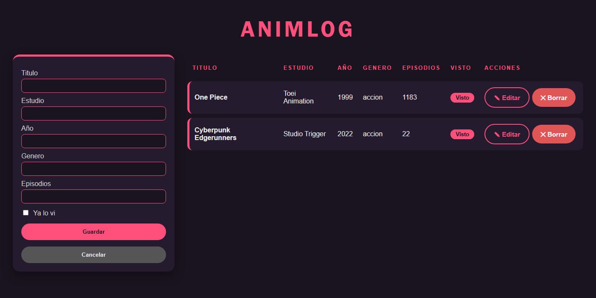
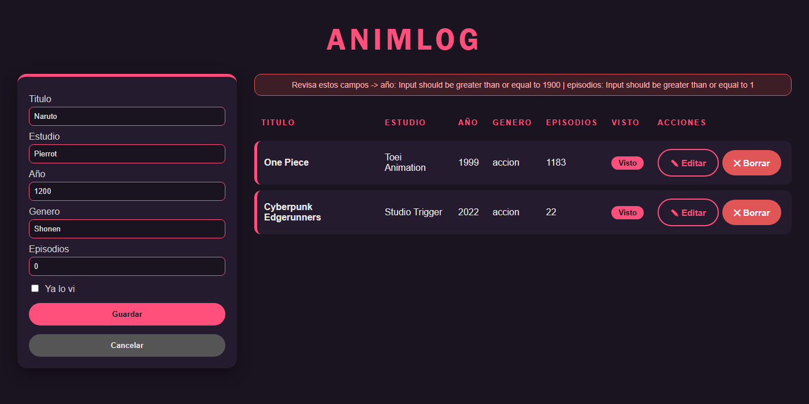

# AnimLOG — Biblioteca de Anime

**Alumno:** Meske Juan Cruz
**Curso:** 6to 5ta
**Materia:** Laboratorio de Programación — TP Evaluativo Full Stack

---

## 1. De qué trata

**AnimLOG** es una aplicación para llevar el registro de los animes que viste o que
querés ver: título, estudio, año, género, cantidad de episodios y si ya lo viste.

Elegí este tema porque tiene los datos justos para completar el trabajo (iba a hacerlo
de juegos, pero eso ya lo hizo otro compañero).

Cada anime tiene estos datos:

- `id`: lo genera la base solo.
- `titulo`, `estudio` y `genero`: texto obligatorio (hasta 100, 100 y 50 letras).
- `año`: número entre 1900 y 2100.
- `episodios`: número entre 1 y 10000.
- `visto`: verdadero/falso, no es obligatorio (si no se manda queda en `false`).

---

## 2. Qué usé

**Backend (el servidor):** Python con **FastAPI** (arma la API y valida datos),
**Uvicorn** (deja corriendo el servidor), **Pydantic** (define cómo son los datos) y
**SQLite** (la base es un solo archivo, `animes.db`).

**Frontend (lo que se ve):** HTML, CSS y JavaScript puro, usando `fetch` para hablar con
el servidor. Sin librerías.

---

## 3. Cómo ejecutarlo

> Probado desde cero en Windows con Python 3.14.

### Backend

```bash
cd backend
python -m venv venv
```

Activar el entorno virtual:

```bash
# Windows (PowerShell)
venv\Scripts\activate

# Linux / Mac
source venv/bin/activate
```

Instalar lo necesario y arrancar:

```bash
pip install -r requirements.txt
uvicorn main:app --reload
```

El servidor queda en **http://127.0.0.1:8000**. La primera vez se crea solo el archivo
`animes.db`.

### Documentación automática

Con el servidor andando, entrá a **http://127.0.0.1:8000/docs**. Ahí se puede probar
cada endpoint con el botón *Try it out*, sin usar el frontend.


### Frontend

En **otra** terminal, con el backend ya corriendo:

- **Opción A (la que usé):** en VS Code, click derecho sobre `frontend/index.html` →
  *Open with Live Server*. Queda en `http://127.0.0.1:5500`.
- **Opción B:**

```bash
cd frontend
python -m http.server 5500
```

> **Ojo:** no abrir el `index.html` con doble clic. Así el navegador bloquea los
> pedidos al servidor (por CORS, que explico en la sección 6).

---

## 4. Endpoints

Un endpoint es una dirección a la que el frontend le pide o le manda datos al servidor.

| Método | Ruta | Qué hace |
|---|---|---|
| GET | `/animes/todos` | Lista todos los animes |
| GET | `/animes/uno/{id}` | Trae un anime por su id |
| POST | `/animes/nuevo` | Crea un anime |
| PUT | `/animes/editar/{id}` | Modifica un anime |
| DELETE | `/animes/borrar/{id}` | Borra un anime |

Todos responden **200** si salió bien.

### Ejemplos de request y response

**GET `/animes/todos`** (sin body) → 200:
```json
[ { "titulo": "Steins;Gate", "estudio": "White Fox", "año": 2011,
    "genero": "Ciencia Ficcion", "episodios": 24, "visto": false, "id": 3 } ]
```

**GET `/animes/uno/3`** (sin body) → 200: devuelve un solo objeto, igual al de arriba.

**POST `/animes/nuevo`** → 200. Request:
```json
{ "titulo": "Vinland Saga", "estudio": "Wit Studio", "año": 2019,
  "genero": "Historico", "episodios": 24, "visto": false }
```
Response: lo mismo, más el `id` que le puso la base (`"id": 4`).

**PUT `/animes/editar/3`** → 200. Request: se manda solo lo que cambió.
```json
{ "visto": true }
```
Response: el anime completo con ese cambio (`"visto": true`).

**DELETE `/animes/borrar/3`** (sin body) → 200:
```json
{ "mensaje": "anime borrado" }
```

**Error 422** (título vacío, año 1200, 0 episodios) → el servidor avisa cada campo mal:
```json
{ "detail": [
  { "loc": ["body", "titulo"],    "msg": "String should have at least 1 character" },
  { "loc": ["body", "año"],       "msg": "Input should be greater than or equal to 1900" },
  { "loc": ["body", "episodios"], "msg": "Input should be greater than or equal to 1" } ] }
```

---

## 5. Capturas

**Listado con datos cargados**



**Error 422 mostrado en pantalla.** El servidor manda el error, `api.js` lo convierte en
un texto fácil de leer y `ui.js` lo muestra en el cartel rojo.



---

## 6. Preguntas de arquitectura


### 6.1 ¿Qué pasa desde que hago clic en "Guardar" hasta que se actualiza la pantalla?


1. Al apretar "Guardar" se dispara el evento `submit`. En `main.js` uso
   `preventDefault()` para que la página no se recargue.
2. `main.js` lee los datos del formulario (con `ui.js`) y pasa `año` y `episodios` a
   número, porque los inputs siempre devuelven texto.
3. Se muestra el cartel "Cargando..." y se llama a `api.js`.
4. `api.js` hace el `fetch` con método POST y manda los datos como JSON al servidor.
5. FastAPI recibe el pedido y **Pydantic revisa los datos antes de todo**. Si algo está
   mal, devuelve 422 y ahí termina.
6. Si está todo bien, el endpoint abre la conexión a la base y llama al Manager.
7. El Manager hace el `INSERT` en SQLite, guarda los cambios (`commit`) y devuelve el
   anime creado con su `id`.
8. `api.js` recibe la respuesta. `main.js` limpia el formulario, vuelve a pedir la lista
   completa y `ui.js` redibuja la tabla.

La pantalla no se actualiza sola: se actualiza porque yo vuelvo a pedir los datos y
los dibujo de nuevo.

### 6.2 ¿Quién es el cliente y quién el servidor? ¿En qué se diferencia de una app de escritorio?

- **Cliente:** el navegador con el HTML, CSS y los tres archivos JS. No sabe nada de la
  base de datos, solo pide y recibe JSON.
- **Servidor:** FastAPI corriendo en el puerto 8000. Es el único que toca la base.

En una app de escritorio todo corre en la misma PC y los datos quedan ahí. Acá hay dos
partes que se hablan por red, los datos están en el servidor y los ven todos, y para
actualizar solo se cambia el servidor.

La diferencia que más se nota al programar: en una app de escritorio llamás a una
función y responde seguro. Acá el pedido viaja por la red y puede fallar o tardar. Por
eso uso `try/catch` y el cartel de "Cargando...".

### 6.3 ¿Qué métodos HTTP y códigos de estado usa el proyecto?

El **método** dice qué querés hacer y el **código** dice cómo salió.

GET lista o trae uno, POST crea, PUT modifica y DELETE borra. Todos devuelven 200 si
salió bien y 422 si los datos o el id no son válidos.

Los códigos se agrupan así:
- **2xx:** salió bien.
- **4xx:** el error es del cliente (por ejemplo, mandé un año de 1200).
- **5xx:** el error es del servidor.

El 422 es el que más aparece, y lo genera Pydantic solo. En `api.js` lo trato aparte
porque trae información útil para el usuario (qué campo está mal y por qué).

### 6.4 ¿Qué es el SOP y por qué hace falta CORS?


El **SOP** es una regla de seguridad de los navegadores: una página solo puede leer
respuestas de su **mismo origen**. Un origen es **protocolo + dominio + puerto**. Si
cambia uno, ya es otro origen.

Sirve para que una página cualquiera no pueda pedirle datos a, por ejemplo, tu banco
mientras estás logueado y leer la respuesta.

**Mi caso:** el frontend está en el puerto 5500 y la API en el 8000. Para el navegador
son orígenes distintos, así que bloquea los pedidos.

**CORS** es la forma de permitirlo de manera controlada: el servidor avisa en qué
orígenes confía. Antes del POST real, el navegador manda un pedido `OPTIONS` para
preguntar si puede. Si el servidor dice que sí, deja pasar el pedido de verdad.

En `main.py` agregué el `CORSMiddleware` con los orígenes `http://127.0.0.1:5500` y
`http://localhost:5500`.

Puse los dos orígenes porque `localhost` y `127.0.0.1` son lo mismo para nosotros, pero
para el navegador son distintos. En una app real no hay que usar `allow_origins=["*"]`,
porque deja entrar a cualquier página.

### 6.5 ¿Para qué sirve separar en Managers y qué aporta la inyección de dependencias?

**Separar responsabilidades** es que cada archivo tenga un solo trabajo:

- `main.py`: recibir pedidos y devolver respuestas.
- `models.py`: definir y validar los datos.
- `managers.py`: hablar con la base (todo el SQL está acá).
- `database.py`: abrir y cerrar la conexión.

Así el endpoint no escribe SQL, solo llama al Manager.

Ventajas: si cambio de base de datos toco solo `managers.py`, si hay un error en una
consulta sé dónde buscar, y no repito el mismo SQL en varios lados.

**Inyección de dependencias** es que el endpoint no crea la conexión, la **recibe ya
lista** con `Depends(get_db)`. Lo bueno: `get_db` siempre cierra la conexión (con un
`finally`), aunque haya un error, y la configuración queda en un solo lugar.

Si abriera conexiones sueltas en cada función, un error antes del `close()` la dejaría
abierta, y con muchos pedidos se pueden trabar.

### 6.6 ¿Por qué JSON y cómo valida Pydantic?

**JSON** es el formato en el que viajan los datos entre frontend y backend. Se usa
porque es texto simple, los dos lenguajes lo entienden (`JSON.stringify()` en
JavaScript, FastAPI en Python) y es fácil de leer cuando hay que revisar errores.

Pero JSON no controla los tipos (nada impide mandar `"año": "mil"`). Ahí entra
**Pydantic**, que pone las reglas. Hice cuatro modelos: `AnimeBase` (campos y reglas comunes), `AnimeCrear` (para el POST,
sin id), `AnimeActualizar` (para el PUT, todo opcional) y `AnimeRespuesta` (lo que
devuelve la API, con id).

Los separé porque el POST no debe aceptar un `id` (lo pone la base) y el PUT tiene que
aceptar campos faltantes para mandar solo lo que cambió.

Pydantic valida **antes** de que corra mi código. Si hay algo mal, devuelve 422 con
todos los errores juntos (como el ejemplo de la sección 4), así al Manager nunca le
llegan datos rotos.

### 6.7 ¿Qué es que HTTP sea "stateless" y dónde vive el estado?

**Stateless** significa que el servidor **no se acuerda de nada entre un pedido y el
siguiente**. Cada pedido trae todo lo que necesita. Por eso el DELETE lleva el id en la
URL: el servidor no puede adivinar cuál quiero borrar.

Dónde vive el estado en mi proyecto:

- Los animes guardados: en `animes.db`, en el servidor.
- La lista que se ve: en la variable `listaAnimes` de `main.js`, hasta recargar.
- El anime que estoy editando: en el input oculto `idAnime`.
- Entre pedidos, en el servidor: nada.

**Ventaja si hubiera que usar 3 servidores:** como ninguno guarda nada en memoria, da lo
mismo cuál atienda cada pedido. Si uno se cae, los otros siguen sin que el usuario se
entere.

Lo único que habría que cambiar es la base: SQLite es un archivo local, así que
habría que pasar a PostgreSQL o MySQL. Gracias a los Managers, eso toca solo
`database.py` y `managers.py`.

---

## 7. Decisiones de diseño

- Tres archivos JS con un trabajo cada uno: `api.js` (solo `fetch`), `ui.js` (solo la
  pantalla) y `main.js` (eventos y coordinación).
- Uso `textContent` y no `innerHTML`, porque si un título tiene `<b>` el navegador lo
  tomaba como HTML y rompía la tabla.
- Los errores se traducen a un texto fácil, y los de datos (422) y de red (servidor
  apagado) tienen mensajes distintos.
- Nombres en español y rutas largas pero claras (`/animes/nuevo`).
- POST y PUT devuelven el anime completo, así el frontend recibe el `id` sin pedirlo.
- El layout es de dos columnas: formulario a la izquierda y tabla a la derecha. Cada fila
  parece una tarjeta, "Visto" se muestra como una insignia y los botones de editar y
  borrar son más grandes y redondeados para que se noten.

---

## 8. Problemas que tuve

- **El puerto 8000 daba `WinError 10013`.** En Windows puede estar reservado (Docker o
  WSL). Usé otro puerto y cambié `URL_BASE` en `api.js`.
- **El `fetch` fallaba sin explicación.** Era CORS; agregué el `CORSMiddleware`.
- **Abrir el HTML con doble clic no andaba.** Hay que usar Live Server.
- **Un título con `<b>` rompía la tabla.** Cambié `innerHTML` por `createElement()` y
  `textContent`.
- **Cambié un campo y los `INSERT` fallaban.** `CREATE TABLE IF NOT EXISTS` no modifica
  una tabla que ya existe. Solución: borrar `animes.db` y dejar que se cree de nuevo.
